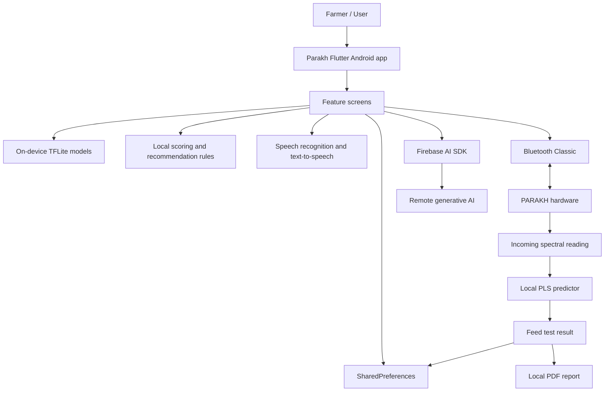
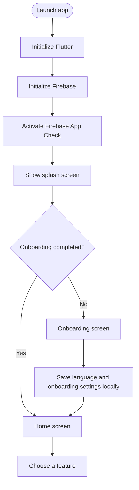
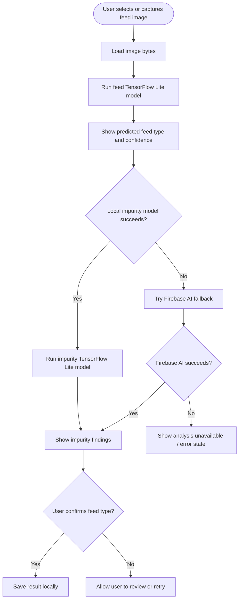
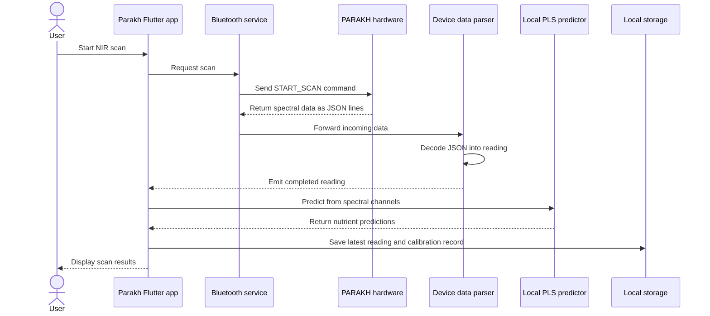
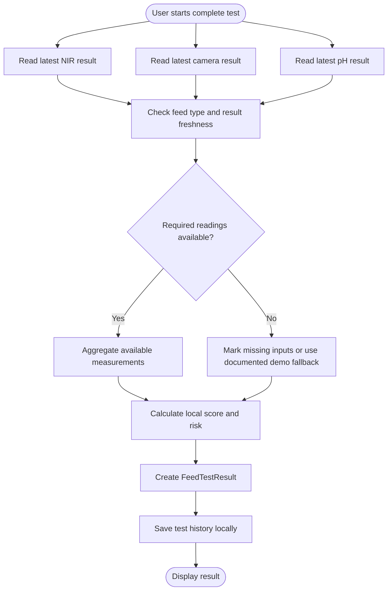
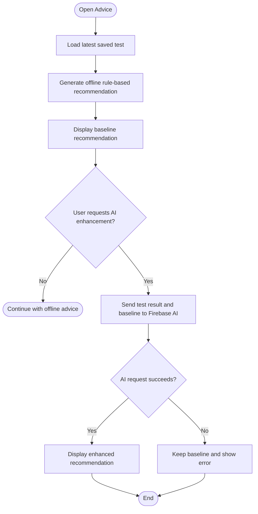
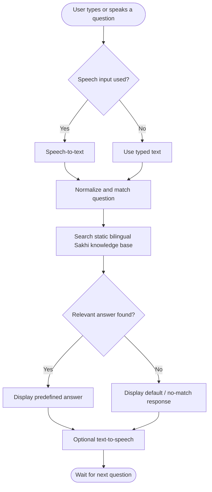
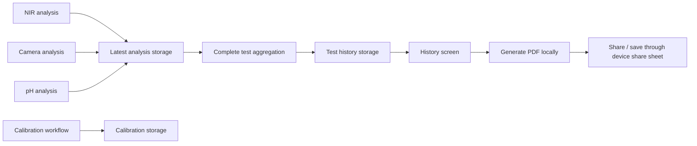

# Parakh

**Parakh** is an Android-focused Flutter application designed to help
assess animal-feed quality by combining readings from a paired PARAKH
hardware device, on-device machine-learning models, image analysis, and
feed-quality recommendations.

The application uses a hybrid architecture: much of the processing runs
locally on the phone, while selected image-analysis and recommendation
features use Firebase AI.

> **Important:** Model predictions and fallback/demo results should not
> be treated as laboratory-validated measurements unless they have been
> validated against appropriate reference tests. The app may display
> prototype or simulated results when a feature cannot produce a
> validated result.

## Features

-   **Feed identification:** Classifies a feed image with a bundled
    TensorFlow Lite model.
-   **Visible impurity screening:** Uses an on-device TensorFlow Lite
    model, with Firebase AI fallback in the feed-identification flow if
    local impurity inference fails.
-   **Camera analysis:** Sends an image to Firebase AI for structured
    visible-impurity analysis.
-   **pH strip analysis:** Uses Firebase AI to interpret a pH-strip
    image and validate the returned result.
-   **NIR nutrient analysis:** Connects to the PARAKH device over
    Bluetooth Classic, receives spectral readings, and predicts nutrient
    values locally with a bundled Partial Least Squares (PLS) model.
-   **Combined feed test:** Aggregates available NIR, camera, and pH
    results into a locally calculated score/risk summary.
-   **Feed recommendations:** Generates a baseline recommendation using
    local rules; an optional action can enhance it with Firebase AI.
-   **Sakhi assistant:** Matches user questions against a static
    bilingual knowledge base. It can use speech-to-text for input and
    text-to-speech for spoken replies. Sakhi does **not** call an LLM or
    custom backend in the inspected implementation.
-   **History and reports:** Stores test history on the device and
    creates shareable PDF reports.
-   **Calibration records:** Keeps calibration entries locally.
-   **Storage monitoring:** Applies local rules to manually entered
    moisture, pH, temperature, and storage-duration values.
-   **Onboarding and language preference:** Saves selected settings
    locally.

## Technology stack

-   **App:** Flutter and Dart
-   **Local image inference:** TensorFlow Lite
-   **NIR prediction:** Local PLS regression calculation using a bundled
    JSON model
-   **Hardware communication:** Bluetooth Classic / Serial Port Profile
    (SPP)
-   **Cloud AI:** Firebase AI SDK
-   **App integrity:** Firebase App Check
-   **Local persistence:** `SharedPreferences`
-   **Speech:** `speech_to_text` and `flutter_tts`
-   **Reports:** Local PDF generation and platform sharing

## Architecture overview



### Where processing happens

  -----------------------------------------------------------------------
  Capability              Processing location     Internet required for
                                                  the feature?
  ----------------------- ----------------------- -----------------------
  Feed image              On-device TensorFlow    No, for the normal path
  classification          Lite                    

  Local impurity          On-device TensorFlow    No, for the normal path
  classification          Lite                    

  NIR measurement         Paired PARAKH hardware, No
                          connected by Bluetooth  

  NIR nutrient prediction Local Dart PLS          No
                          calculation             

  Baseline recommendation Local rule-based        No
                          service                 

  Sakhi responses         Local static knowledge  No
                          base                    

  pH-strip image analysis Firebase AI             Yes

  Standalone camera       Firebase AI             Yes
  analysis                                        

  Impurity fallback after Firebase AI             Yes
  local inference fails                           

  Optional AI             Firebase AI             Yes
  recommendation                                  
  enhancement                                     

  History, calibration,   On-device               No
  and PDF generation                              
  -----------------------------------------------------------------------

Firebase initialization and App Check activation occur before the app UI
starts, so startup itself currently depends on successful Firebase
initialization even though many individual features work locally after
startup.

## Workflow diagrams

The diagrams below show the main user journeys and where processing takes place.

### 1. App startup and navigation



### 2. Feed identification and impurity screening



### 3. NIR hardware scan and nutrient prediction



### 4. Complete feed test



### 5. Advice and optional AI enhancement



### 6. Sakhi assistant



### 7. Data storage and report generation



> **Implementation note:** These diagrams describe the workflows identified in the inspected code. Some branches are fallbacks, and the exact path depends on runtime success, available readings, and user actions. Local storage refers to on-device `SharedPreferences`, not a cloud database.

## NIR measurement flow

1.  The user connects to the paired PARAKH device from the
    device-connection screen.
2.  The user starts an NIR scan and selects the relevant feed/profile
    options.
3.  The app sends a scan command over Bluetooth.
4.  The device returns newline-delimited JSON data containing the
    spectral reading.
5.  The app parses the message into a reading model.
6.  The bundled PLS predictor standardizes the spectral channels and
    calculates predicted nutrient values.
7.  The app displays the result and saves the latest reading and
    calibration record locally.

The phone does not perform the physical spectroscopy measurement; that
originates from the connected hardware.

## Data and backend notes

The inspected repository does **not** contain a confirmed custom REST
backend. No application-defined REST API client or server implementation
was found in the inspected snapshot.

The current implementation uses Firebase Core, Firebase App Check, and
Firebase AI. The inspected code does not confirm use of Firebase
Authentication, Firestore, Realtime Database, Firebase Storage, or
Supabase for application data persistence. Test history, latest analysis
records, and calibration records are stored locally using
`SharedPreferences`; they are not automatically synced to a cloud
database.

Some screens contain prototype or simulated fallbacks. A combined test
may use a demo NIR reading if no suitable reading is available. Camera
or pH screens may also show prototype fallback results after analysis
errors. Check the result status and validation flags before interpreting
a displayed result as a real measurement.

## Project structure

The repository follows a mostly feature-first layout with shared models,
services, storage, and theme code under `lib/`.

``` text
lib/
├── main.dart
├── firebase_options.dart
├── core/
│   ├── models/       # Reading, analysis, and test-result models
│   ├── services/     # Bluetooth, ML, AI, recommendations, reports
│   ├── storage/      # Local persistence helpers
│   └── theme/        # Shared visual theme
└── features/
    ├── splash/
    ├── onboarding/
    ├── home/
    ├── device/
    ├── feed_identification/
    ├── camera_analysis/
    ├── ph_analysis/
    ├── analysis/             # NIR analysis
    ├── complete_test/
    ├── advice/
    ├── sakhi/
    ├── history/
    ├── calibration/
    └── storage_monitoring/
```

The exact files and feature folders may change as the project evolves.

## Requirements

-   Flutter SDK compatible with the version specified by the project.
-   Dart SDK compatible with the Flutter installation.
-   Android Studio or another Android development environment.
-   Android device/emulator for general app development.
-   A compatible PARAKH hardware unit for real NIR scans.
-   Firebase project configuration and permitted Firebase AI access for
    cloud-assisted features.

Bluetooth and speech features depend on Android permissions and platform
support. The inspected Firebase configuration is Android-specific; web,
iOS, desktop, and other platforms are not configured by the current
`firebase_options.dart`.

## Run locally

1.  Clone the repository:

    ``` bash
    git clone <repository-url>
    cd <repository-directory>
    ```

2.  Install Flutter dependencies:

    ``` bash
    flutter pub get
    ```

3.  Confirm Firebase is configured for your development environment. The
    repository includes `lib/firebase_options.dart`; do not publish
    private credentials or replace project configuration without
    authorization. Firebase AI features also require the corresponding
    service to be enabled and App Check to accept the app.

4.  Connect an Android device or start an emulator, then run:

    ``` bash
    flutter devices
    flutter run
    ```

5.  For a release build:

    ``` bash
    flutter build apk --release
    ```

    Install the generated APK on a compatible Android device and test
    hardware/Bluetooth features on the actual device. An emulator cannot
    substitute for the PARAKH hardware connection.

> The commands above are standard Flutter commands. A successful build
> does not by itself verify Firebase AI access, Bluetooth compatibility,
> sensor calibration, or the scientific accuracy of predictions.

## Testing checklist

Before a demonstration or release, verify the following on the target
Android device:

-   [ ] App starts successfully with the configured Firebase project and
    App Check.
-   [ ] Onboarding and language preference work.
-   [ ] Feed identification returns a result and handles low-confidence
    predictions.
-   [ ] Impurity analysis clearly distinguishes actual analysis from
    fallback/error states.
-   [ ] pH analysis reports failures rather than presenting a prototype
    fallback as a validated measurement.
-   [ ] PARAKH hardware pairs and reconnects correctly.
-   [ ] NIR scans return a complete reading and handle
    timeouts/disconnections.
-   [ ] PLS predictions have been compared with appropriate
    laboratory/reference measurements.
-   [ ] Combined tests identify missing or simulated inputs.
-   [ ] Offline recommendations remain available when Firebase AI is
    unavailable.
-   [ ] Sakhi handles supported questions and clearly responds when no
    knowledge-base answer matches.
-   [ ] History, calibration entries, and PDF reports work after app
    restart.
-   [ ] Android permissions and speech input/output work on supported
    devices.

## Limitations and future work

-   Sakhi currently uses predefined knowledge-base matching rather than
    open-ended generative AI.
-   Local model predictions need appropriate validation against
    reference/laboratory measurements before being relied on for
    important feed decisions.
-   Local records are device-specific and are not confirmed to sync to a
    cloud database.
-   Firebase initialization is required at startup in the current
    implementation.
-   Prototype/simulated fallback paths should be made visually explicit
    and kept separate from validated readings.
-   A custom backend, remote user accounts, and cloud synchronization
    are not confirmed in the inspected repository.

## Contributing

1.  Create a feature branch.
2.  Keep device communication, local inference, remote AI calls, and
    persistence clearly separated.
3.  Test offline and failure paths, not only the successful path.
4.  Do not commit secrets, signing keys, or private service credentials.
5.  Update this README when the app's features, model assets, or setup
    process changes.

## Disclaimer

Parakh is a technical project for feed assessment and decision support.
Do not treat its output as a substitute for laboratory testing or
qualified veterinary/nutrition advice unless the relevant measurements
and models have been independently validated.
