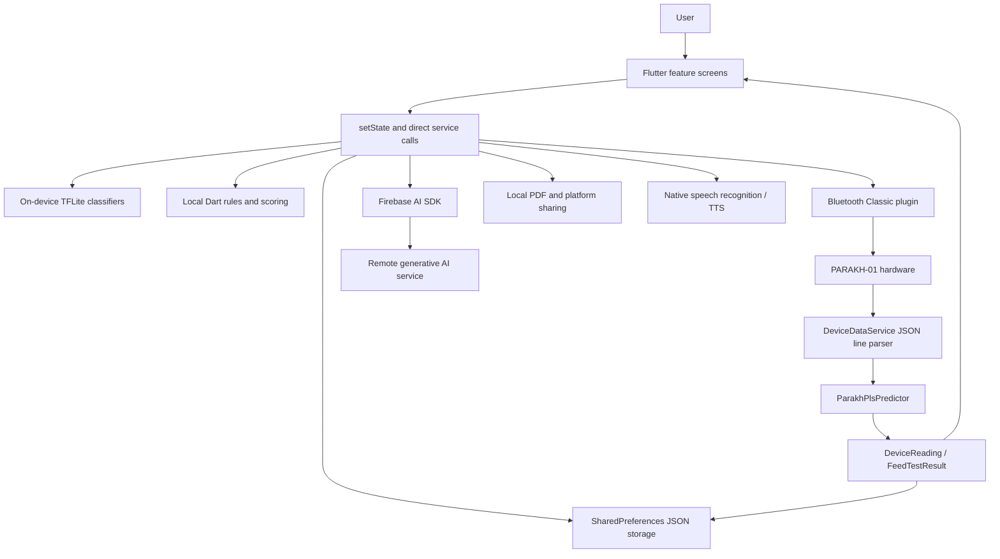
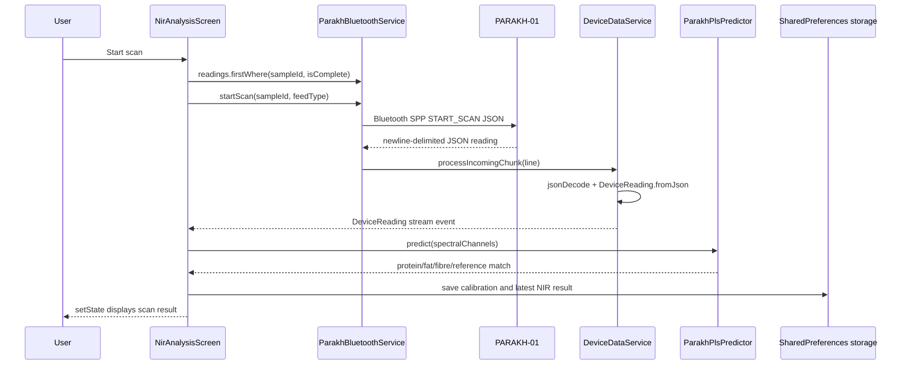

# Parakh Flutter Repository: Architectural Analysis

**Analysis date:** 2026-10-24  
**Scope:** Repository contents only; no runtime device, Firebase console, network trace, or hosted-environment verification was available.

## Executive summary

Parakh is an Android-focused Flutter application with a mostly feature-first UI and a small `core` layer. It does not contain a custom backend implementation in the repository. Its architecture is **hybrid and third-party-service-dependent**:

- Local Flutter/device processing handles UI state, rule-based scoring, TFLite feed classification, TFLite impurity fallback, PLS nutrient prediction, Bluetooth transport/parsing, PDF generation, speech/TTS integration, and local persistence.
- Firebase is initialized before the UI starts and Firebase AI is used directly from the client for pH analysis, camera impurity fallback, feed-identification AI code that currently has no caller, and optional recommendation enhancement.
- The primary NIR measurement originates in the paired `PARAKH` Bluetooth device. Nutrient inference after the spectral payload arrives is performed locally using the bundled PLS JSON model.
- There is no HTTP/Dio/GraphQL client, explicit REST endpoint, Firebase Auth/Firestore/Storage call, Supabase integration, or custom server source in the inspected repository.

Startup is Firebase-dependent, but most individual local features can execute without internet after the app has started. pH analysis and AI-enhanced recommendations require network access and Firebase/App Check acceptance.

## 1. Project structure and startup

### Entry point and initialization

The entry point is [`lib/main.dart`](lib/main.dart):

1. `main()` calls `WidgetsFlutterBinding.ensureInitialized()` ([`lib/main.dart:10-11`](lib/main.dart)).
2. It awaits `Firebase.initializeApp(options: DefaultFirebaseOptions.currentPlatform)` ([`lib/main.dart:13`](lib/main.dart)).
3. It awaits `FirebaseAppCheck.instance.activate(...)`, using `AndroidDebugProvider` in debug and `AndroidPlayIntegrityProvider` otherwise ([`lib/main.dart:15-19`](lib/main.dart)).
4. Only after both Firebase operations succeed does it call `runApp(const ParakhApp())` ([`lib/main.dart:21`]).
5. `ParakhApp` creates a `MaterialApp` with the custom light theme and `SplashScreen` as `home` ([`lib/main.dart:24-35`]).

This means Firebase initialization and App Check are required for startup, even though the application has substantial local functionality.

[`lib/firebase_options.dart`](lib/firebase_options.dart) provides only an Android configuration. `currentPlatform` throws `UnsupportedError` for web, iOS, macOS, Windows, Linux, and unsupported platforms ([`lib/firebase_options.dart:18-51`]). The Android project is associated with Firebase project `parakh-sih-2026` ([`lib/firebase_options.dart:55-60`]; values intentionally not reproduced here).

### Startup sequence after `runApp`

`SplashScreen.initState()` starts logo animation and schedules `_openNextScreen` after 2.8 seconds ([`lib/features/splash/splash_screen.dart:30-45`]). `_openNextScreen()` reads `tutorialCompleted` and `language` from `SharedPreferences`, then uses `Navigator.pushReplacement` to open either:

- `HomeScreen(isHindi: ...)` when onboarding is complete; or
- `OnboardingScreen` otherwise.

There is no named-route table. Routing is performed with `MaterialPageRoute` calls from screens, for example the splash replacement ([`lib/features/splash/splash_screen.dart:45-63`]) and navigation from home.

### State management and dependency injection

No Riverpod, Provider, Bloc, GetX, Redux, or other state-management package is declared. State is held directly in `StatefulWidget` state objects with `setState`. Examples include `HomeScreen`, `FeedIdentificationScreen`, `PhAnalysisScreen`, `NirAnalysisScreen`, and `AdviceScreen`.

There is no dependency-injection container or registration module. Dependencies are instantiated in widgets:

- `PhAnalysisScreen` constructs `PhAnalysisAiService` and `LatestAnalysisStorage` ([`lib/features/ph_analysis/ph_analysis_screen.dart:22-24`]).
- `FeedIdentificationScreen` constructs its local classifiers, Firebase camera service, and storage ([`lib/features/feed_identification/feed_identification_screen.dart:27-39`]).
- `NirAnalysisScreen` uses the process-wide `ParakhBluetoothService.instance` and constructs storage/model futures ([`lib/features/analysis/nir_analysis_screen.dart:35-41`]).

The one explicit singleton is `ParakhBluetoothService.instance` ([`lib/core/services/parakh_bluetooth_service.dart:6-12`]).

### Layers and connections

The repository has these practical layers:

| Layer | Location | Responsibility |
|---|---|---|
| App shell/theme | `lib/main.dart`, `lib/core/theme/` | Firebase startup, `MaterialApp`, theme/colors |
| Feature/UI | `lib/features/**` | Screens, interaction, local widget state, navigation |
| Models | `lib/core/models/` | JSON/value objects such as `DeviceReading`, `FeedTestResult`, and analysis results |
| Device/integration services | `lib/core/services/parakh_bluetooth_service.dart`, `device_data_service.dart` | Bluetooth connection, commands, newline framing, JSON parsing |
| Local ML/calculation services | `feed_classifier_service.dart`, `impurity_classifier_service.dart`, `parakh_pls_predictor.dart`, offline rule services | Bundled model inference and deterministic rules |
| Remote AI services | `*_ai_service.dart` | Direct Firebase AI `generateContent` calls and response mapping |
| Persistence | `lib/core/storage/` | JSON strings and string lists in `SharedPreferences` |
| Output/integration | `test_report_service.dart`, speech/TTS packages | Local PDF creation/sharing and native speech services |

The UI calls services directly rather than through repositories or use-case classes. Models are passed directly between screens/services and storage.

## 2. Actual service inventory

| Service | Purpose and implementation | Actual caller(s) and data flow | Processing location / network / persistence |
|---|---|---|---|
| `ParakhBluetoothService` | Paired-device discovery, secure SPP connection, `GET_STATUS`, `START_SCAN`, `STOP_SCAN`, and incoming line stream ([`lib/core/services/parakh_bluetooth_service.dart:20-108`](lib/core/services/parakh_bluetooth_service.dart)) | `DeviceConnectionScreen` calls discovery/connect/disconnect ([`lib/features/device/device_connection_screen.dart:70-165`](lib/features/device/device_connection_screen.dart)); `NirAnalysisScreen._startScan()` subscribes to `readings`, sends `startScan`, and waits for a matching complete sample ([`lib/features/analysis/nir_analysis_screen.dart:304-340`](lib/features/analysis/nir_analysis_screen.dart)) | Bluetooth/native device; no internet; no remote persistence |
| `DeviceDataService` | Buffers newline-delimited messages, JSON-decodes `DeviceReading`, and publishes a stream ([`lib/core/services/device_data_service.dart:6-50`](lib/core/services/device_data_service.dart)) | Owned by `ParakhBluetoothService`; `processIncomingChunk` is called for each Bluetooth line ([`lib/core/services/parakh_bluetooth_service.dart:48-57`](lib/core/services/parakh_bluetooth_service.dart)) | Flutter memory and local parsing; no network; `generateDemoReading` exists but no application caller was found |
| `ParakhPlsPredictor` | Loads `assets/models/parakh_pls_model.json`, standardizes spectral channels, applies coefficients/intercept, clamps outputs, and computes reference match ([`lib/core/services/parakh_pls_predictor.dart:35-159`](lib/core/services/parakh_pls_predictor.dart)) | `NirAnalysisScreen._startScan()` calls `load()` and `predict()` after the Bluetooth reading is complete ([`lib/features/analysis/nir_analysis_screen.dart:37-38`, `lib/features/analysis/nir_analysis_screen.dart:341-362`](lib/features/analysis/nir_analysis_screen.dart)) | Entirely local Flutter/Dart calculation; no network; output saved locally |
| `FeedClassifierService` | Loads `parakh_feed_classifier.tflite` and labels, resizes the image to 224x224, runs TFLite, and applies a 0.65 manual-confirmation threshold ([`lib/core/services/feed_classifier_service.dart:17-82`](lib/core/services/feed_classifier_service.dart)) | `FeedIdentificationScreen._analyseImage()` calls `classify()` first ([`lib/features/feed_identification/feed_identification_screen.dart:127-162`](lib/features/feed_identification/feed_identification_screen.dart)) | On-device TFLite; no network; result is held in widget state and feed type is saved in `SharedPreferences` on confirmation |
| `ImpurityClassifierService` | Loads `parakh_impurity_classifier.tflite`, runs local image inference, and maps one predicted label to four visible-impurity findings ([`lib/core/services/impurity_classifier_service.dart:21-130`](lib/core/services/impurity_classifier_service.dart)) | `FeedIdentificationScreen._analyseImage()` uses it before Firebase fallback ([`lib/features/feed_identification/feed_identification_screen.dart:164-190`](lib/features/feed_identification/feed_identification_screen.dart)) | On-device TFLite; no network in the normal path; camera result can be persisted locally |
| `CameraAnalysisAiService` | Sends an image and JSON-schema prompt to `FirebaseAI.googleAI().generativeModel(model: 'gemini-3.8-flash')`, then validates/maps findings ([`lib/core/services/camera_analysis_ai_service.dart:8-18`, `lib/core/services/camera_analysis_ai_service.dart:91-174`](lib/core/services/camera_analysis_ai_service.dart)) | Standalone `CameraAnalysisScreen` calls it directly ([`lib/features/camera_analysis/camera_analysis_screen.dart:70-111`]); feed identification calls it only if local impurity inference throws ([`lib/features/feed_identification/feed_identification_screen.dart:164-190`]) | Remote Firebase AI; network required; result is optionally saved to local `SharedPreferences` |
| `PhAnalysisAiService` | Sends pH-strip image to Firebase AI and validates pH, confidence, strip quality, and chart status ([`lib/core/services/ph_analysis_ai_service.dart:8-18`, `lib/core/services/ph_analysis_ai_service.dart:58-151`](lib/core/services/ph_analysis_ai_service.dart)) | `PhAnalysisScreen._analyseStrip()` calls it ([`lib/features/ph_analysis/ph_analysis_screen.dart:71-125`]) | Remote Firebase AI; network/App Check required; usable result is locally cached |
| `FeedIdentificationAiService` | A separate Firebase AI feed-identification implementation with structured predictions ([`lib/core/services/feed_identification_ai_service.dart:8-18`, `lib/core/services/feed_identification_ai_service.dart:67-136`](lib/core/services/feed_identification_ai_service.dart)) | No call site was found in `lib`; the active feed-identification screen uses `FeedClassifierService` instead | Declared/implemented remote capability, but not an application-used service in this repository |
| `OfflineRecommendationService` | Deterministic recommendation rules using feed reference bands, impurity status, pH availability, simulated-data flags, and validation state ([`lib/core/services/offline_recommendation_service.dart:5-8`, `lib/core/services/offline_recommendation_service.dart:14-170`](lib/core/services/offline_recommendation_service.dart)) | `AdviceScreen._loadLatestRecommendation()` generates a recommendation from the latest complete local test ([`lib/features/advice/advice_screen.dart:41-68`]) | Local Dart rules; no network; input comes from local history |
| `FeedRecommendationAiService` | Sends `FeedTestResult` plus offline baseline to Firebase AI and maps bounded bilingual recommendations ([`lib/core/services/feed_recommendation_ai_service.dart:8-18`, `lib/core/services/feed_recommendation_ai_service.dart:57-151`](lib/core/services/feed_recommendation_ai_service.dart)) | Optional action `_enhanceRecommendationWithAi()` in `AdviceScreen` ([`lib/features/advice/advice_screen.dart:209-258`]) | Remote Firebase AI; baseline remains available offline; enhanced result is held in widget state and is not saved to remote storage |
| `LatestAnalysisStorage` | Stores latest NIR/camera/pH JSON with feed type and timestamp; rejects stale entries older than 30 minutes ([`lib/core/storage/latest_analysis_storage.dart:5-128`](lib/core/storage/latest_analysis_storage.dart)) | NIR, camera, and pH screens save results; complete test reads all three ([`lib/features/complete_test/complete_test_screen.dart:207-218`]) | Local `SharedPreferences`; no cloud persistence |
| `TestHistoryStorage` | Stores complete tests as a JSON string list, sorted by date; supports deletion/clear ([`lib/core/storage/test_history_storage.dart:5-64`](lib/core/storage/test_history_storage.dart)) | `CompleteTestScreen` saves; home/advice/history read it ([`lib/features/complete_test/complete_test_screen.dart:285-289`]) | Local `SharedPreferences`; no network |
| `CalibrationStorage` | Stores pending/lab calibration records as JSON string lists ([`lib/core/storage/calibration_storage.dart:5-77`](lib/core/storage/calibration_storage.dart)) | NIR saves a pending record; calibration screen reads/updates it ([`lib/features/analysis/nir_analysis_screen.dart:369-378`](lib/features/analysis/nir_analysis_screen.dart) and [`lib/features/calibration/calibration_screen.dart:17-46`](lib/features/calibration/calibration_screen.dart)) | Local `SharedPreferences`; no remote lab API |
| `TestReportService` | Builds a PDF from `FeedTestResult` and shares it through `Printing.sharePdf` ([`lib/core/services/test_report_service.dart:9-18`, `lib/core/services/test_report_service.dart:181-191`](lib/core/services/test_report_service.dart)) | `HistoryScreen` constructs and uses it ([`lib/features/history/history_screen.dart:19`](lib/features/history/history_screen.dart)) | Local PDF generation plus platform share sheet; no application backend |
| `SakhiKnowledgeBase` | Static bilingual question/answer matching; `SakhiAssistantScreen._ask()` calls `findAnswer` ([`lib/core/services/sakhi_knowledge_base.dart:3-6`, `lib/features/sakhi/sakhi_assistant_screen.dart:115-139`](lib/features/sakhi/sakhi_assistant_screen.dart)) | Sakhi UI; `speech_to_text` captures input and `flutter_tts` speaks output ([`lib/features/sakhi/sakhi_assistant_screen.dart:17-28`, `lib/features/sakhi/sakhi_assistant_screen.dart:47-109`]) | Local knowledge base plus native speech services; speech recognition may use Android/provider services, but no custom backend is called |
| `StorageMonitoringScreen` rules | Parses manually entered moisture/pH/temperature/days and computes thresholds in `_riskLevel()` ([`lib/features/storage_monitoring/storage_monitoring_screen.dart:42-78`](lib/features/storage_monitoring/storage_monitoring_screen.dart)) | Button invokes `_analyseStorage()` ([`lib/features/storage_monitoring/storage_monitoring_screen.dart:42-64`, `lib/features/storage_monitoring/storage_monitoring_screen.dart:451`]) | Local widget calculation; no network or persistence found |
| `offline_ph_analysis_service.dart` | File exists but is empty (only a blank first line in the inspected worktree) | No class or caller | No runtime service exists in the current repository |

## 3. End-to-end feature traces

### A. Feed image identification and visible impurity screening

Representative call chain:

```text
FeedIdentificationScreen image button
  -> _pickImage(ImageSource)
  -> ImagePicker.pickImage() -> XFile.readAsBytes()
  -> _analyseImage()
  -> FeedClassifierService.classify()
  -> FeedClassifierService.load()
  -> Interpreter.run() on parakh_feed_classifier.tflite
  -> FeedIdentificationResult (offline-tflite)
  -> ImpurityClassifierService.analyse()
  -> Interpreter.run() on parakh_impurity_classifier.tflite
  -> CameraAnalysisResult (offline-tflite)
  -> setState() updates the UI
  -> _confirmFeed()
  -> SharedPreferences identifiedFeedType + LatestAnalysisStorage.saveCameraResult()
```

Evidence: image acquisition and state reset are in [`lib/features/feed_identification/feed_identification_screen.dart:70-105`](lib/features/feed_identification/feed_identification_screen.dart); the orchestration is [`lib/features/feed_identification/feed_identification_screen.dart:107-205`](lib/features/feed_identification/feed_identification_screen.dart).

If local impurity inference throws, the screen tries `CameraAnalysisAiService.analyse()`, which sends the image remotely through Firebase AI. If that also fails, the UI keeps the feed classification but marks impurity screening unavailable and shows a SnackBar ([`lib/features/feed_identification/feed_identification_screen.dart:164-205`](lib/features/feed_identification/feed_identification_screen.dart)). Thus, the normal path is offline, with remote AI as a fallback.

### B. Standalone camera analysis

```text
CameraAnalysisScreen._analyseImage()
  -> CameraAnalysisAiService.analyse()
  -> GenerativeModel.generateContent(Content.multi(TextPart + InlineDataPart))
  -> jsonDecode and schema/value validation
  -> CameraAnalysisResult
  -> LatestAnalysisStorage.saveCameraResult() when a feed type exists
  -> setState(_analysisResult, _showResult)
```

The service uses a multimodal Firebase AI request, not a repository or custom REST client ([`lib/core/services/camera_analysis_ai_service.dart:91-174`](lib/core/services/camera_analysis_ai_service.dart)). Errors are mapped by `AiFailure.fromError()` into quota, overload, network, App Check, invalid-image, or generic user messages ([`lib/core/services/ai_error_handler.dart:10-91`](lib/core/services/ai_error_handler.dart)). On failure, the screen displays a prototype result rather than a validated remote result ([`lib/features/camera_analysis/camera_analysis_screen.dart:70-123`](lib/features/camera_analysis/camera_analysis_screen.dart)).

### C. pH strip analysis

```text
PhAnalysisScreen._analyseStrip()
  -> ImagePicker result bytes
  -> PhAnalysisAiService.analyse()
  -> FirebaseAI GenerativeModel.generateContent()
  -> JSON decode, pH/quality/chart validation and clamping
  -> PhAnalysisResult
  -> save usable result, otherwise clear cached pH result
  -> setState() displays result
```

The actual remote call and mapping are [`lib/core/services/ph_analysis_ai_service.dart:58-151`](lib/core/services/ph_analysis_ai_service.dart). A network/App Check/AI failure causes the screen to construct `PhAnalysisResult.prototype(...)`, show it, and display a localized failure message ([`lib/features/ph_analysis/ph_analysis_screen.dart:106-140`](lib/features/ph_analysis/ph_analysis_screen.dart)). This fallback is a UI/model fallback, not an offline pH image-analysis implementation; the repository contains no implemented offline pH service.

### D. NIR scan and nutrient prediction

```text
NirAnalysisScreen._startScan()
  -> require animal profile, supported feed, and connected device
  -> ParakhBluetoothService.readings.firstWhere(sampleId + isComplete)
  -> ParakhBluetoothService.startScan()
  -> Bluetooth Classic writes START_SCAN JSON
  -> device returns newline-delimited JSON
  -> DeviceDataService.processIncomingChunk()
  -> DeviceReading.fromJson()
  -> ParakhPlsPredictor.load()
  -> ParakhPlsPredictor.predict(spectralChannels)
  -> DeviceReading.withNutrientPrediction()
  -> CalibrationStorage.saveRecord()
  -> LatestAnalysisStorage.saveNirReading()
  -> setState() displays result
```

The gate checks and command/wait sequence are [`lib/features/analysis/nir_analysis_screen.dart:210-340`](lib/features/analysis/nir_analysis_screen.dart). The local PLS calculation and output clamping are [`lib/features/analysis/nir_analysis_screen.dart:341-378`](lib/features/analysis/nir_analysis_screen.dart) and [`lib/core/services/parakh_pls_predictor.dart:91-159`](lib/core/services/parakh_pls_predictor.dart).

The actual sensor measurement is external to the Flutter process (the paired PARAKH device), but the app-to-device transport is local Bluetooth and nutrient prediction is local. There is no HTTP request. If Bluetooth disconnects, the command/stream wait fails and the UI shows `Scan failed`; a timeout is 20 seconds ([`lib/features/analysis/nir_analysis_screen.dart:315-340`](lib/features/analysis/nir_analysis_screen.dart)).

### E. Complete test aggregation

`CompleteTestScreen._startCompleteTest()` is not a new measurement pipeline. It waits through four presentation steps, reads the most recent matching NIR/camera/pH records from `LatestAnalysisStorage`, and uses `DeviceReading.demo()` when NIR data is absent ([`lib/features/complete_test/complete_test_screen.dart:136-218`](lib/features/complete_test/complete_test_screen.dart)).

It computes score/risk locally, marks missing modules, constructs a `FeedTestResult`, saves it with `TestHistoryStorage.saveResult()`, and displays “Result saved offline” ([`lib/features/complete_test/complete_test_screen.dart:229-289`](lib/features/complete_test/complete_test_screen.dart)). It makes no network request and does not itself invoke Bluetooth or AI.

### F. Advice and recommendation enhancement

Advice first loads the latest complete local history item and calls `OfflineRecommendationService.generate()` ([`lib/features/advice/advice_screen.dart:41-68`](lib/features/advice/advice_screen.dart)). That baseline is available offline and explicitly flags simulated/unvalidated data.

The optional “enhance with AI” action calls `FeedRecommendationAiService.enhance()` with both the test result and offline baseline ([`lib/features/advice/advice_screen.dart:209-258`](lib/features/advice/advice_screen.dart)). Firebase AI returns bounded bilingual JSON; failure leaves the offline baseline in place and displays a localized error. The enhanced recommendation is not written to `TestHistoryStorage`, so it is session/UI state unless another screen saves it.

### G. Sakhi assistant, reports, and storage monitor

- Sakhi matches text against the static `SakhiKnowledgeBase`, optionally obtains text through native speech recognition, and speaks the answer with native TTS. No Firebase or custom backend call exists in [`lib/features/sakhi/sakhi_assistant_screen.dart:47-139`](lib/features/sakhi/sakhi_assistant_screen.dart).
- History loads local `FeedTestResult` values and `TestReportService` constructs/shares a PDF locally; no upload is performed.
- Storage monitoring validates manually entered values and applies local thresholds in `_riskLevel()`. It has no persistence or network call.

## 4. Backend dependency verdict

### Classification

**Primary classification: Hybrid + third-party-service-dependent.**

More specifically:

1. **No custom backend confirmed in this repository.** There is no `server`, `api`, `routes`, `controllers`, HTTP client, or backend source tree in the inspected project. `firebase.json` contains a Firebase Functions deployment stanza pointing to a `functions` source directory ([`firebase.json:21-31`](firebase.json)), but no `functions/` files were present in the repository snapshot. Therefore, a deployable Functions backend cannot be confirmed from this checkout.
2. **Direct third-party backend/service usage is confirmed.** Firebase Core and App Check are initialized at startup, and four AI service classes construct Firebase AI generative models. The actual used paths are pH, camera fallback/standalone camera, and optional recommendation enhancement. The feed-identification AI class exists but has no caller.
3. **No Firebase cloud database/auth/storage usage is confirmed.** The code imports `firebase_core`, `firebase_app_check`, and `firebase_ai`, but no Firebase Auth, Firestore, Realtime Database, or Storage APIs were found.
4. **Startup is remote-service dependent.** `Firebase.initializeApp` and App Check activation are awaited before `runApp`; a failure can prevent the UI from starting.
5. **Core local workflows are not all backend-dependent.** Local TFLite classification, local impurity fallback, local NIR PLS prediction after Bluetooth data, local rule recommendations, history, calibration records, PDF creation, and storage monitoring do not require an application backend.

### Remote endpoints

No literal REST URL, base URL, endpoint path, HTTP method, Dio client, `package:http`, GraphQL client, or environment-variable URL was found. Firebase AI endpoint details are encapsulated by the `firebase_ai` SDK and are not represented as application-defined URLs.

## 5. Architecture and data-flow diagrams

### High-level architecture



### Most important feature: NIR data flow



## 6. Feature processing-location matrix

| Feature | Entry Point | Processing Location | Backend/External Service | Data Storage | Evidence |
|---|---|---|---|---|---|
| App startup | `main()` | Flutter initialization plus Firebase SDK | Firebase Core and App Check; required before UI | None | `lib/main.dart:10-21` |
| Onboarding/language/demo settings | `SplashScreen`, onboarding/home | Flutter widgets | None | `SharedPreferences` | `lib/features/splash/splash_screen.dart:45-63` |
| Feed identification | `FeedIdentificationScreen._analyseImage` | On-device TFLite in normal path | Firebase AI only in local impurity fallback; unused AI identification class has no caller | Confirmed feed type and latest camera result in `SharedPreferences` | `lib/features/feed_identification/feed_identification_screen.dart:107-205`, `lib/core/services/feed_classifier_service.dart:25-82` |
| Visible impurity screen | Feed identification or camera screen | TFLite first; remote multimodal AI fallback/standalone | Firebase AI (`gemini-3.8-flash`) | Latest camera result locally | `lib/core/services/impurity_classifier_service.dart:51-130`, `lib/core/services/camera_analysis_ai_service.dart:91-174` |
| pH strip analysis | `PhAnalysisScreen._analyseStrip` | Remote multimodal AI | Firebase AI (`gemini-3.8-flash`) | Usable latest pH result locally | `lib/features/ph_analysis/ph_analysis_screen.dart:71-140` |
| NIR scan | `NirAnalysisScreen._startScan` | Hardware measurement over Bluetooth, then local PLS calculation | PARAKH-01 over Bluetooth Classic; no internet | Latest NIR and calibration records locally | `lib/features/analysis/nir_analysis_screen.dart:304-378` |
| Complete test | `CompleteTestScreen._startCompleteTest` | Local aggregation, scoring, and simulated fallback | None | Complete history locally | `lib/features/complete_test/complete_test_screen.dart:136-289` |
| Offline advice | `AdviceScreen._loadLatestRecommendation` | Local deterministic rules | None | Reads local history | `lib/core/services/offline_recommendation_service.dart:8-170` |
| AI advice enhancement | `AdviceScreen._enhanceRecommendationWithAi` | Remote generative model with local baseline | Firebase AI (`gemini-3.8-flash`) | UI state only for enhanced result | `lib/features/advice/advice_screen.dart:209-258` |
| Calibration records | `CalibrationScreen` | Local form/rules | No lab API; user-entered lab values | `SharedPreferences` | `lib/core/storage/calibration_storage.dart:5-77` |
| History | `HistoryScreen` | Local read/delete and PDF creation | Native share/printing plugin | `SharedPreferences`; generated PDF in memory | `lib/core/services/test_report_service.dart:9-191` |
| Sakhi assistant | `SakhiAssistantScreen` | Static matching plus native speech/TTS | Android speech/TTS providers may be involved; no app backend | None found | `lib/features/sakhi/sakhi_assistant_screen.dart:47-139` |
| Storage monitoring | `StorageMonitoringScreen._analyseStorage` | Local threshold rules | None | None found | `lib/features/storage_monitoring/storage_monitoring_screen.dart:42-78` |

## 7. Persistence and offline behavior

### Persistence

The only application persistence mechanism found is `SharedPreferences`:

- `LatestAnalysisStorage` stores three latest-result JSON blobs and applies a 30-minute age check ([`lib/core/storage/latest_analysis_storage.dart:5-128`](lib/core/storage/latest_analysis_storage.dart)).
- `TestHistoryStorage` stores a JSON string list for complete tests ([`lib/core/storage/test_history_storage.dart:5-64`](lib/core/storage/test_history_storage.dart)).
- `CalibrationStorage` stores calibration records as a JSON string list ([`lib/core/storage/calibration_storage.dart:5-77`](lib/core/storage/calibration_storage.dart)).
- Screens also store settings and profile fields directly, including language, tutorial completion, demo mode, feed type, animal profile, and sample counters.

No SQLite, Hive, Isar, file database, cloud database, remote cache, or upload queue was found.

### Offline capability

Works without internet once startup has completed:

- Feed classification with the bundled TFLite model.
- Impurity screening with the bundled TFLite model.
- NIR device communication and local PLS prediction, assuming Bluetooth hardware is available.
- Offline rule recommendations.
- Complete-test aggregation and history.
- Calibration record editing.
- PDF generation/sharing, subject to platform share availability.
- Storage monitoring.
- Static Sakhi answers and much of native speech/TTS behavior, subject to device/provider availability.

Requires network/Firebase AI:

- pH image analysis.
- Standalone camera AI analysis.
- Camera impurity fallback when local TFLite throws.
- Optional AI recommendation enhancement.

If Firebase/App Check fails before `runApp`, the app may not reach the screens at all. If an AI request fails after startup, the screens show localized errors and use a prototype or offline baseline fallback where implemented.

## 8. Authentication, configuration, and security observations

- No user authentication or authorization flow was found. There is no Firebase Auth usage, login state, token refresh, role check, or backend authorization layer.
- App Check is configured at startup with debug provider for debug builds and Play Integrity for non-debug Android builds ([`lib/main.dart:15-19`](lib/main.dart)).
- Firebase Android configuration is committed in generated/config files and includes an API key and project identifiers ([`lib/firebase_options.dart:55-60`](lib/firebase_options.dart), [`android/app/google-services.json`](android/app/google-services.json)). The report intentionally omits the key. These client Firebase identifiers are commonly distributed with Android apps, but Firebase console restrictions and App Check enforcement must be verified separately.
- AI prompts and image bytes are sent from the client to the Firebase AI SDK. The repository does not show a server-side privacy boundary, consent flow, upload retention policy, or redaction layer.
- Local `SharedPreferences` data is not shown as encrypted. It includes animal profile details, feed results, calibration records, and timestamps. This is a client-side exposure consideration on rooted/compromised devices.
- `ParakhBluetoothService.startScan()` interpolates `sampleId` and `feedType` into a JSON string ([`lib/core/services/parakh_bluetooth_service.dart:95-101`](lib/core/services/parakh_bluetooth_service.dart)); the UI controls these values, but a structured encoder would be safer for arbitrary future input.
- Error handling is inconsistent: AI paths use a shared classifier, while `DeviceDataService.tryParseMessage()` silently drops malformed device messages ([`lib/core/services/device_data_service.dart:30-50`](lib/core/services/device_data_service.dart)). This may make hardware protocol problems difficult to diagnose.

## 9. Potential architectural issues

These are observations, not confirmed production defects:

1. **UI-to-service coupling:** Screens instantiate and orchestrate services directly. There are no repositories/use cases, making testing and replacement of Firebase/local implementations harder.
2. **Duplicate/unused AI paths:** `FeedIdentificationAiService` is fully implemented but has no caller, while `FeedIdentificationScreen` uses a local classifier. `offline_ph_analysis_service.dart` is empty. These can mislead maintainers about the active architecture.
3. **Startup coupling to Firebase:** Firebase/App Check is awaited before `runApp`, so an optional AI dependency effectively gates all local features.
4. **Fallback semantics:** pH failure creates a prototype result in the UI, while camera failure creates a prototype result and feed impurity failure can leave the impurity result unavailable. The distinction is represented in some model fields but is easy for callers to overlook.
5. **No durable sync/backend model:** Results are local-only. There is no account, cloud history, multi-device synchronization, remote audit trail, server-side validation, or server-side laboratory workflow.
6. **Hardware protocol responsibility is concentrated:** Bluetooth connection management, command construction, framing, parsing, and stream publication are all in two service classes without a versioned protocol adapter.
7. **Silent malformed-data handling:** Invalid local JSON history/calibration entries and malformed Bluetooth messages are ignored. This preserves usable records but can hide corruption or firmware incompatibility.
8. **AI model configuration is embedded:** Model name, prompts, schemas, and safety strings are compiled into client code. Updating them requires an app release unless the SDK configuration is changed externally.
9. **Validation is intentionally absent:** `isValidated`/`isLaboratoryValidated` defaults to false and the app labels outputs as screening/prototype. This is appropriate for caution, but there is no remote validation service in the repository.

## 10. Unresolved questions

The repository alone cannot verify:

- Whether a Firebase Functions deployment exists outside this checkout, despite the `firebase.json` source stanza.
- Firebase console settings, App Check enforcement state, AI quota/billing, model availability, regional routing, retention, or security rules.
- The firmware implementation and exact sensor algorithm inside PARAKH-01.
- Whether Android speech recognition sends audio to a vendor cloud; the app delegates that behavior to the platform/provider.
- Whether the committed Firebase client configuration is restricted appropriately in the Firebase console.
- Whether there are backend services in another repository or hosted separately.
- Real-world accuracy of TFLite/PLS/AI outputs or laboratory correlation.
- Whether iOS support is intended; current Firebase options explicitly reject iOS.

## Plain-English explanation

The app is a Flutter client that does most of its work on the phone. The phone can classify feed pictures with models shipped inside the app, calculate nutrient estimates locally after receiving sensor data over Bluetooth, apply recommendation rules, save history locally, and generate reports. The PARAKH hardware is a nearby Bluetooth data source, not a web backend.

Firebase is still important: the app initializes Firebase before showing any screen, and several image/recommendation features send data to Firebase AI. Those features are remote and need internet/App Check. There is no evidence here of a custom API server, user account system, cloud database, or server-side business-logic layer. Therefore, the most accurate description is a **client-heavy hybrid app with direct third-party Firebase AI dependencies and local/offline persistence**.
